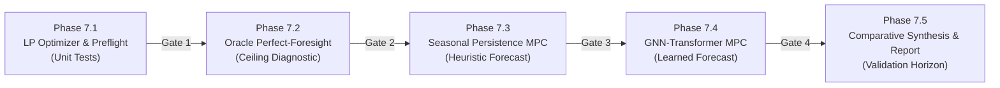

# Part 7 Architecture Specification — Model-Based Predictive Battery Control

**Project:** Adaptive Energy Brain  
**Phase:** Part 7 (Model Predictive Control, Multi-Step Forecast Integration, and Benchmark Synthesis)  
**Date:** 2026-11-15  
**Status:** Architectural Proposal (Awaiting User Review and Approval)  

---

## 1. Executive Summary and Motivation

In Parts 1–4, we built and verified a deterministic, physical microgrid simulator and four causal rule-based baselines. In Part 5, we developed and evaluated multi-step spatial-temporal graph neural network forecasters (`GNNTransformerForecaster`) alongside strong statistical baselines (Seasonal Persistence, Historical Average, and Persistence), verified causal observation integration via `ForecastFeature`, and evaluated them on the test partition. In Part 6, exhaustive empirical diagnostics demonstrated that tabula-rasa, model-free on-policy PPO collapsed to a discharge-only policy due to an empirical $-\$48$ charging advantage deficit in rollout buffers, despite verified information equivalence and ample network capacity.

**Part 7 establishes a Model Predictive Control (MPC) architecture** that directly bridges the forecasting engine (Part 5) and the physical simulation environment (Parts 3–4). By solving a constrained optimization problem over a rolling horizon, MPC explicitly reasons about future prices, solar/wind generation, and campus demand, eliminating the temporal credit-assignment failure that incapacitated model-free policy gradients.

---

## 2. Core Architecture and Component Integration

```mermaid
flowchart TD
    subgraph Part 3 & 4: Physical Simulation & Observation
        SIM["MicrogridEnvironment<br/>(Deterministic Physics)"] -->|Causal Observation| OBS["AgentObservation<br/>(SOC, Price, Load, PV, Wind)"]
    end

    subgraph Part 5: Multi-Step Forecasting Pipeline
        HIST["Historical Lookback (24h)"] --> FC_ENGINE{"Forecasting Engine"}
        FC_ENGINE -->|Learned| GNN["GNN-Transformer Forecaster"]
        FC_ENGINE -->|Heuristic Benchmark| SP["Seasonal Persistence Forecaster"]
        FC_ENGINE -->|Ceiling Diagnostic| ORACLE["Perfect Foresight (Oracle)"]
        GNN --> ADAPT["adapt_node_forecasts()<br/>(Integration Helper)"]
        SP --> ADAPT
        ORACLE --> ADAPT
        ADAPT -->|Typed ForecastFeatures| OBS
    end

    subgraph Part 7: Model Predictive Controller
        OBS --> MPC["Rolling-Horizon MPC Controller"]
        MPC --> FORM["Linear Program (LP) Formulation<br/>(Horizon H=24h)"]
        FORM --> SOLVE["Solver: scipy.optimize.linprog<br/>(HiGHS Simplex / IPM)"]
        SOLVE --> PLAN["Planned Battery Trajectory<br/>[P_0, P_1, ..., P_{H-1}]"]
        PLAN --> ACT["Select First Action: a_0 = P_0"]
    end

    ACT -->|BatteryAction(P_0)| SIM
    SIM -->|Step Dispatch & State Advance| SIM
```

---

## 3. Ten Core Architectural Dimensions

### 3.1 Forecast Input and Output Interfaces
- **Integration Boundary:** Reuses `src/forecasting/integration.py` (`adapt_node_forecasts`), developed in Part 5.11.
- **Input to Adapter:** Multi-step node predictions of shape `[horizon, 8, 1]` in physical kW, matching node order `(B01..B05, PV01, W01, BUS01)` with target mask excluding BUS01.
- **Output of Adapter:** Three validated `ForecastFeature` series attached directly to `AgentObservation.forecasts`:
  1. `campus_demand_kw`: Sum of building loads B01–B05.
  2. `solar_generation_kw`: Generation from PV01.
  3. `wind_generation_kw`: Generation from W01.
- **Tariff Interface:** Since synthetic electricity tariffs are deterministic and cyclic (11:00–16:00 UTC peak at \$0.18/kWh, remaining 19 hours at \$0.12/kWh), the tariff schedule over horizon $H$ is generated directly from the current timestamp via `configs/synthetic_scenario.yaml`.

### 3.2 Forecast Horizon and Time Alignment
- **Primary Planning Horizon:** $H = 24\text{ hours}$ (hourly steps $\Delta t = 1.0\text{ h}$).
- **Rationale for $H = 24$:**
  - Matches the 24-hour diurnal cycle of the synthetic campus tariff and solar irradiance.
  - Aligns with the 24-step forecast horizon evaluated in Part 5.
  - Fully spans the duration between daily off-peak charging windows and peak discharging windows.
- **Time Alignment Contract:** For decision timestamp $t$, the forecast covers target hours $t+1, t+2, \dots, t+H$. Lookback uses historical steps $t-L+1, \dots, t$ where $L = 24\text{ h}$.

### 3.3 Battery State-of-Charge and Power Constraints
At each step $k \in \{0, 1, \dots, H-1\}$ of the optimization horizon:
- **Energy Balance:**
  $$E_{k+1} = E_k + \left(\eta_c P_{c, k} - \frac{P_{d, k}}{\eta_d}\right) \Delta t$$
- **Storage Boundaries:**
  $$E_{\min} \le E_k \le E_{\max} \quad \forall k \in \{1, \dots, H\}$$
  Where $E_{\min} = 0.10 \times 500 = 50.0\text{ kWh DC}$, $E_{\max} = 0.90 \times 500 = 450.0\text{ kWh DC}$.
- **Power Limits:**
  $$0 \le P_{c, k} \le P_{c, \max} = 150.0\text{ kW AC}$$
  $$0 \le P_{d, k} \le P_{d, \max} = 150.0\text{ kW AC}$$
- **Simultaneous Flow Investigation & Conditions:**
  In a continuous LP formulation, charging ($P_{c, k}$) and discharging ($P_{d, k}$) are separate nonnegative decision variables. Positive degradation cost ($c_{\text{deg}} > 0$) and round-trip efficiency losses ($\eta_c \cdot \eta_d = 0.9025 < 1$) penalize round-trip battery throughput. Under standard strictly positive import tariffs ($p_{\text{import}} > 0$) and non-negative export prices ($p_{\text{export}} \le p_{\text{import}}$), simultaneously charging from the bus and discharging to the bus within the same hour incurs immediate throughput degradation ($2 \cdot c_{\text{deg}} \cdot P$) and efficiency destruction without supplying net power to the load or grid.
  However, **positive degradation and efficiency losses do not universally guarantee physical exclusivity under all possible edge conditions**:
  1. If electricity prices become negative ($p_{\text{import}} < 0$) and export is barred, an LP may attempt to consume excess power via battery round-trip dissipation.
  2. If unserved load penalties or degenerate constraints exist, simultaneous flows can emerge on non-strictly convex LP faces.
  3. Simultaneous grid importing ($P_{\text{import}} > 0$) and grid exporting ($P_{\text{export}} > 0$) can occur if export compensation exceeds import cost (an arbitrage condition not present in this scenario).
  Therefore, physical exclusivity cannot be silently assumed as universally guaranteed. The solver must explicitly detect simultaneous flow instances ($\min(P_{c, k}, P_{d, k}) > 10^{-6}$ and $\min(P_{\text{import}, k}, P_{\text{export}, k}) > 10^{-6}$) and record solver diagnostics. If edge cases produce simultaneous flows, binary indicator variables (MILP) or penalty reformulations must be evaluated under explicit approval.

### 3.4 Efficiency and Degradation Accounting
- **Conversion Efficiency:** $\eta_c = 0.95$ (AC-to-DC charge), $\eta_d = 0.95$ (DC-to-AC discharge). Round-trip efficiency $\eta_{\text{rt}} = \eta_c \cdot \eta_d = 0.9025$.
- **Linear Degradation Cost:** $c_{\text{deg}} = 0.02\text{ USD per AC kWh throughput}$ (`configs/simulation_costs.yaml`).
  $$\text{Degradation Cost}_k = c_{\text{deg}} \cdot (P_{c, k} + P_{d, k}) \Delta t$$

### 3.5 Optimization Objective and Terminal Inventory Valuation
The objective minimizes total modeled operating cost over the $H$-hour horizon, augmented by a **terminal inventory valuation** to mitigate greedy end-of-horizon battery depletion:

$$\min_{\mathbf{P}_c, \mathbf{P}_d, \mathbf{P}_{\text{grid}}} \sum_{k=0}^{H-1} \left( p_{\text{import}, k} P_{\text{import}, k} - p_{\text{export}, k} P_{\text{export}, k} + c_{\text{deg}} (P_{c, k} + P_{d, k}) \right) \Delta t - v_{\text{term}} \cdot (E_H - E_0)$$

- **Terminal Inventory Valuation ($v_{\text{term}}$):**
  The reference value $v_{\text{term}} = v_{\text{ref}} = (0.12 + 0.02) / 0.95 = 0.14736842\text{ USD/kWh DC}$ is an **explicit modeling assumption** derived from the steady-state off-peak replacement cost, **not a mathematically proven optimal terminal value**. In rolling-horizon control, the true marginal value of stored energy at step $H$ depends dynamically on future renewable availability and multi-day price profiles. The controller treats $v_{\text{term}}$ as a configurable parameter, evaluated across multiple levels (including $v_{\text{term}} = 0.0$) rather than assuming it prevents all end-of-horizon depletion.
- **Power Balance Constraint:**
  At each step $k$, campus load must be satisfied:
  $$P_{\text{import}, k} - P_{\text{export}, k} + P_{d, k} - P_{c, k} + P_{\text{solar}, k} + P_{\text{wind}, k} - P_{\text{curtail}, k} = P_{\text{load}, k}$$
  $$0 \le P_{\text{import}, k} \le P_{\text{import}, \max} = 2000.0\text{ kW}$$
  $$0 \le P_{\text{export}, k} \le P_{\text{export}, \max} = 500.0\text{ kW}$$

### 3.6 Forecast Uncertainty and Robustness
- **Uncertainty Risk:** If the forecaster overestimates solar generation or underestimates campus load during peak hours, the MPC policy may discharge too early or fail to reserve sufficient energy.
- **Handling Strategy:**
  1. **Certainty Equivalence MPC (Baseline):** Solves deterministic LP using expected point forecasts.
  2. **Conservative Headroom Margin (Optional):** Adds a small reserve band (e.g., maintaining minimum SOC at $0.20$ rather than $0.10$ during unpeaked periods) to buffer against unexpected demand spikes.
  3. **Sensitivity Audits:** Explicitly measure how MPC dispatch cost degrades as a function of forecast MAE.

### 3.7 Causal Information Boundaries
- **Strict Non-Anticipativity:** At decision step $t$, the controller accesses:
  - Current observation state (current SOC, active grid price, current load/generation).
  - Forecasts issued $\le t$ targeting steps $t+1, \dots, t+H$.
  - Historical measurements prior to $t$.
- **No Simulator Leakage:** The MPC controller has zero visibility into future simulation replay rows, future realized generation, or internal simulator structures.

### 3.8 Rolling-Horizon Execution
1. At time step $t$, receive causal `AgentObservation`.
2. Extract current energy $E_0 = \text{battery\_soc} \times 500\text{ kWh}$.
3. Formulate the $H$-step Linear Program using forecasted load, solar, wind, and tariffs.
4. Solve the LP for optimal control sequence $\mathbf{P}^* = [P_0^*, P_1^*, \dots, P_{H-1}^*]$.
5. Execute **only the first action**: $a_t = \text{BatteryAction}(P_0^*)$.
6. The physical simulator executes $a_t$, enforces physical constraints, logs actual dispatch, and advances state to $t+1$.
7. Repeat at step $t+1$ with updated initial state and rolling forecast window.

### 3.9 Computational Complexity and Solver Architecture
- **Problem Class:** Continuous Linear Program (LP) with $H$ time steps.
  - Number of decision variables: $6 \times H = 144$ variables (for $H = 24$).
  - Number of linear constraints: $\sim 10 \times H = 240$ constraints.
- **Solver Choice:** Python's built-in `scipy.optimize.linprog` using the **HiGHS** solver (`method='highs'`).
- **Performance Characteristics (Design Expectations):**
  - Expected solution time per LP step: Estimated at $< 20\text{ ms}$ on standard CPU; exact runtime is to be empirically measured during implementation rather than assumed.
  - Requires **zero external or proprietary solver dependencies** (no Gurobi, CPLEX, or MOSEK needed).

### 3.10 Benchmark Hierarchy and Comparative Protocol
To maintain rigorous methodological evaluation, MPC variants will be compared against established baselines on the common 1,313-hour validation split:

| Benchmark Level | Controller Name | Description | Role in Study |
| :--- | :--- | :--- | :--- |
| **Level 0** | `zero_action` | Requests 0 kW idle. | Passive reference baseline. |
| **Level 1** | `price_aware` | Rule-based causal threshold heuristic. | Established reference. |
| **Level 2** | `discrete_price_aware` | Discrete(3) threshold heuristic (\$43,632.76). | Best-known causal heuristic. |
| **Level 3** | `seasonal_persistence_mpc` | MPC driven by 24-hour seasonal persistence. | Simple forecasting benchmark. |
| **Level 4** | `gnn_transformer_mpc` | MPC driven by Part 5 GNN-Transformer forecaster. | Learned forecasting benchmark. |
| **Level 5** | `oracle_mpc` (Diagnostic) | Rolling-horizon MPC given perfect future 24-hour lookahead. | Diagnostic rolling reference with perfect 24-hour lookahead; not necessarily a global optimum over the entire multi-week horizon due to finite-horizon rolling truncation. |

> [!IMPORTANT]
> The `oracle_mpc` is an analytical diagnostic reference to establish the theoretical performance upper bound under perfect 24-hour rolling information. It will be evaluated **strictly on training/validation partitions**, never accessing held-out test data.

---

## 4. Review of Part 5 Forecasting Risks and Error Propagation

### 4.1 Lessons from Part 5 Test Evaluation
In the Part 5 completion evaluation on test windows, the aggregate metrics were:

| Method | Test MAE (kW) | Test RMSE (kW) | Relative Rank |
| :--- | :--- | :--- | :--- |
| **Seasonal Persistence** | **9.3719** | **16.2025** | **1st (Best)** |
| **GNN-Transformer** | 12.6947 | 17.2082 | 2nd |
| **Historical Average** | 24.9920 | 37.4353 | 3rd |
| **Persistence** | 29.6110 | 51.5081 | 4th |

**Key Risk & Methodological Nuance:**
The learned GNN-Transformer model **did not outperform 24-hour seasonal persistence** in aggregate test error. However, **forecast accuracy differences do not alone establish the cause of MPC cost differences**.
- Dispatch performance emerges from the complex closed-loop coupling of forecast trajectories, state feedback, and constraint activation. A forecast with slightly higher aggregate RMSE may still yield lower dispatch costs if its peak timing is better aligned, or conversely, a low-RMSE forecast with consistent bias at critical tariff transition boundaries may induce suboptimal battery cycling.
- Evaluating both `seasonal_persistence_mpc` and `gnn_transformer_mpc` isolates and quantifies these closed-loop interactions.
| **Persistence** | 29.6110 | 51.5081 | 4th |

**Key Risk:** The learned GNN-Transformer model **did not outperform 24-hour seasonal persistence** in aggregate test error.
- **Implication for Part 7:** If an MPC controller using GNN-Transformer underperforms Seasonal Persistence MPC, the cause is likely **forecasting accuracy**, not control formulation.
- **Mitigation:** Evaluating both `seasonal_persistence_mpc` and `gnn_transformer_mpc` ensures full transparency and isolates control efficiency from forecasting error.

### 4.2 Forecast Error Modes in Battery Dispatch
1. **Solar Overestimation:** Causes the battery to remain empty in anticipation of solar charging that never materializes, forcing high-cost peak grid imports.
2. **Demand Underestimation:** Causes battery discharge to be undersized during peak hours, incurring peak grid import penalties.
3. **Phase / Timing Jitter:** Shifting peak demand by 1 hour can cause premature discharge before peak tariffs activate.

---

## 5. Phased Implementation Roadmap and Approval Gates

To maintain strict repository and scientific integrity, Part 7 will proceed through five phased milestones, each requiring explicit verification before advancing:



### Phase 7.1: Preflight & Optimization Formulation
- Implement standalone optimization solver `src/control/mpc_solver.py` using `scipy.optimize.linprog`.
- Implement unit tests verifying:
  - Energy conservation and efficiency loss accounting.
  - Constraint adherence ($E_{\min}, E_{\max}, P_{\max}$).
  - Exact objective matching with manual small-scale LP instances.
  - Zero-cost idle when tariff is flat.
- *Gate 1 Approval:* 100% unit test pass rate; zero simulator or physics modifications.

### Phase 7.2: Perfect-Foresight Oracle Diagnostic
- Implement `OracleMPCController` reading ahead on validation replay data within a strictly bounded window.
- Evaluate on 1,313-hour validation split.
- Establish the theoretical minimum operating cost achievable under perfect foresight.
- *Gate 2 Approval:* Verified feasibility, zero physical violations, report generation.

### Phase 7.3: Seasonal Persistence MPC
- Implement `SeasonalPersistenceMPCController` using lagged 24-hour history.
- Evaluate on 1,313-hour validation split.
- Quantify performance degradation relative to the Oracle.
- *Gate 3 Approval:* Verified causal execution via standard `BaselineController` API.

### Phase 7.4: GNN-Transformer MPC Integration
- Integrate Part 5 checkpoint via `src/forecasting/integration.py`.
- Evaluate `GNNTransformerMPCController` on 1,313-hour validation split.
- Compare head-to-head with Seasonal Persistence MPC.
- *Gate 4 Approval:* Direct comparison showing whether learned representations yield economic benefit over seasonal persistence.

### Phase 7.5: Synthesis and Final Test Evaluation (Separate Approval Required)
- Synthesize all controllers on validation data across raw cost, inventory-adjusted cost, and constraint adjustments.
- If and only if separately approved by the user, run the frozen best-performing controller on the held-out test partition.

---

## 6. Initial Implementation Scope and Required Tests (Phase 7.1)

For the initial implementation step (Phase 7.1), the scope will be strictly bounded:
1. **Target Files to Create:**
   - `src/control/mpc_solver.py`: Core mathematical optimization module.
   - `configs/mpc_controller.yaml`: Versioned configuration parameters ($H=24$, $v_{\text{term}}$, bounds).
   - `tests/test_mpc_solver.py`: Dedicated preflight unit tests.
2. **Required Preflight Tests:**
   - `test_lp_formulation_feasibility`: Verifies solver finds feasible solution for standard profile.
   - `test_battery_energy_bounds_enforced`: Verifies $E_k \in [50, 450]\text{ kWh}$ across horizon.
   - `test_efficiency_and_degradation_loss`: Verifies that throughput degradation cost and round-trip loss are correctly penalized.
   - `test_terminal_inventory_credit`: Verifies that increasing terminal valuation $v_{\text{term}}$ preserves stored energy at $k=H$.
   - `test_arbitrage_behavior`: Verifies charging during off-peak and discharging during peak on synthetic 24-hour tariff profile.
   - `test_execution_speed`: Verifies that a 24-step solve completes in $< 20\text{ ms}$.

---

## 7. Risks, Assumptions, and Open Questions

1. **Solver Numerical Stability:**
   - *Assumption:* `scipy.optimize.linprog` with `method='highs'` is numerically stable and standard across all platforms.
   - *Risk:* Edge cases with floating-point tolerance could cause minor power balance residuals ($\sim 10^{-12}$).
   - *Mitigation:* Explicit tolerance checks in unit tests.
2. **Terminal Energy Weight Tuning:**
   - *Assumption:* Setting $v_{\text{term}} = v_{\text{ref}} = 0.147368\text{ USD/kWh DC}$ aligns planning with long-term replacement cost.
   - *Open Question:* Does the optimal rolling dispatch change if $v_{\text{term}}$ is varied between off-peak cost (\$0.12) and peak price (\$0.18)?
3. **Simultaneous Charge/Discharge in LP:**
   - *Assumption:* The solver will never simultaneously charge and discharge due to non-zero round-trip losses and positive degradation costs.
   - *Mitigation:* Assert that $\min(P_c, P_d) \le 10^{-6}$ in all solver outputs.
4. **Computational Budget:**
   - *Assumption:* Local CPU can solve 1,313 LP instances sequentially in under 30 seconds without multithreading issues.
